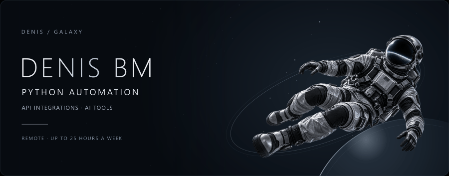

[Русская версия](README.md) · [Email](mailto:denis@burakovv.ru) · [Telegram](https://t.me/YgalaxyY)

## Hi, I'm Denis

I'm looking for a **remote Python internship or an entry-level role with mentorship**, focused on file and spreadsheet automation, Telegram bots, APIs and integrations with existing AI services.

I'm a **fifth-year Computer Security student in a Specialist degree program at Don State Technical University**, Rostov-on-Don. Expected graduation: **2028**. I'm available for **up to 25 hours a week**, with a part-time or flexible schedule.

## Selected projects

These are personal and educational projects built with substantial AI assistance. I'm strengthening my Python fundamentals and studying their implementation. The linked READMEs distinguish available source code, project technologies and limitations.

| Project | Scope | Public materials |
| --- | --- | --- |
| [Excel Merge Core](https://github.com/YgalaxyY/concatenate_multiple_excel) | Small Python GUI prototype for combining Excel reports | Source code, setup requirements and known limitations |
| [BookMarkCore](https://github.com/YgalaxyY/GalaxyOS_BookMarkCore) | Telegram links, classification through an LLM API and GitHub publishing | Source code and configuration notes |
| [Cardora](https://github.com/YgalaxyY/Cardora-AI-Automation) | Desktop workflow for product images, Photoshop and spreadsheets | Showcase and demo materials; application source is not public |
| [DeepSynth Research](https://github.com/YgalaxyY/deepsynth-research) | Educational audio-visual deepfake-detection experiment | Source and methodology; corrected-protocol benchmark results pending |

## Learning focus

Python, files, JSON, pandas, openpyxl and HTTP APIs are my current focus. Other personal projects use aiogram, GitHub API and existing language models. These are project technologies, not a claim of advanced proficiency or independent model development.

I also have one month of system-administration experience at **Tatrum, September–October 2024**, involving electronic document workflows, access-control systems and 1C.

## Other projects

- [Local LLM Roleplay Lab](https://github.com/YgalaxyY/local-llm-roleplay-lab): local-model and UI setup around upstream SillyTavern.
- [Eco Banking Tracker](https://github.com/YgalaxyY/eco-banking-tracker): educational web application with simulated data and no banking integration.
- [Sewing factory management](https://github.com/YgalaxyY/Sawing-Company): student C#, WinForms and MySQL project.
- [Swarm of Agents](https://github.com/YgalaxyY/Swarm-of-agents): experiment configuring roles for Roo Code and Ollama.

## Contact

[denis@burakovv.ru](mailto:denis@burakovv.ru) · [Telegram @YgalaxyY](https://t.me/YgalaxyY)

Remote · up to 25 hours a week · Python internship or entry-level role with mentorship.
