
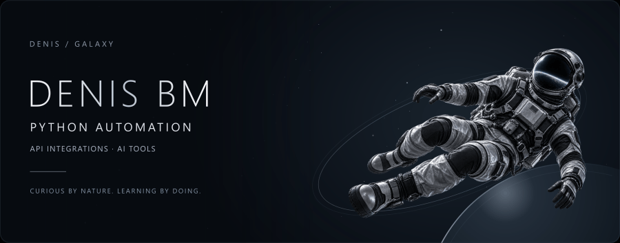

  
  
  
  

### Hi, I'm Denis

I'm interested in **Python, automation and AI tools**, from files and spreadsheets to Telegram bots, APIs and local language models. This profile brings together Cardora Studio, my commercial product, and selected personal and student projects.

I'm studying **Computer Security in a Specialist degree program at Don State Technical University**, Rostov-on-Don. Expected graduation: **2028**.

See the linked repositories for implementation details, releases and setup instructions.

<a href="https://github.com/YgalaxyY/GalaxyOS_BookMarkCore"></a>

  
  

  <a href="https://github.com/YgalaxyY/concatenate_multiple_excel">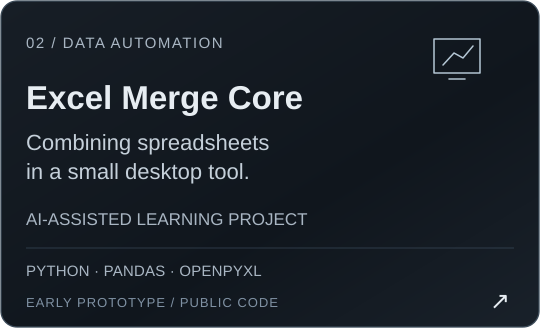</a>&nbsp;&nbsp;
  <a href="https://github.com/YgalaxyY/Cardora-AI-Automation">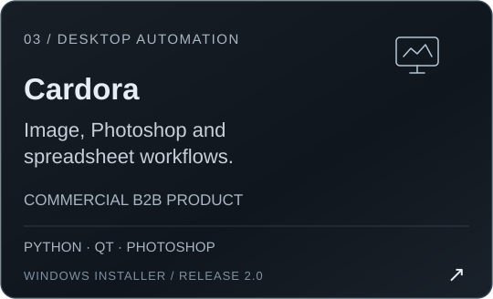</a>

  <a href="https://github.com/YgalaxyY/deepsynth-research">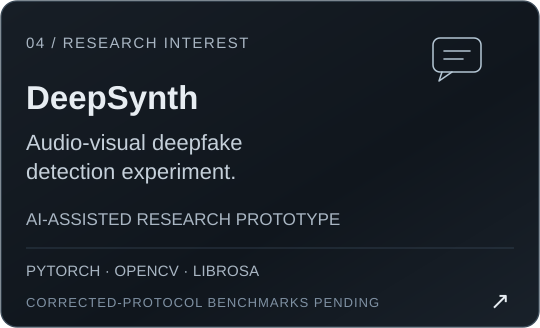</a>&nbsp;&nbsp;
  <a href="https://github.com/YgalaxyY/local-llm-roleplay-lab">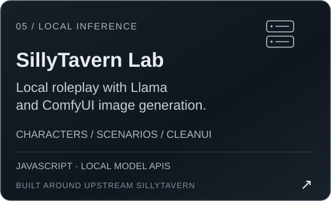</a>

### Other projects

  <a href="https://github.com/YgalaxyY/eco-banking-tracker">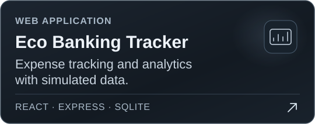</a>
  <a href="https://github.com/YgalaxyY/Sawing-Company">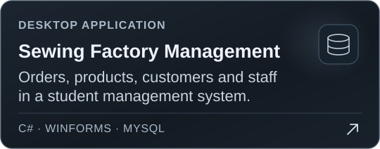</a>

  <a href="https://github.com/YgalaxyY/Swarm-of-agents">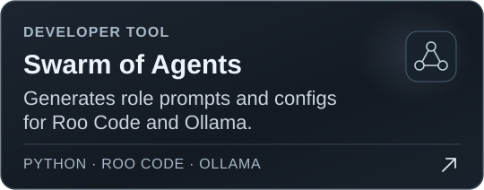</a>
  <a href="https://github.com/YgalaxyY/Adobe-JSXBIN-Decoder">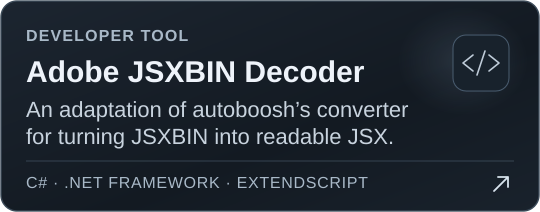</a>

  <a href="https://github.com/YgalaxyY/House-of-the-sun">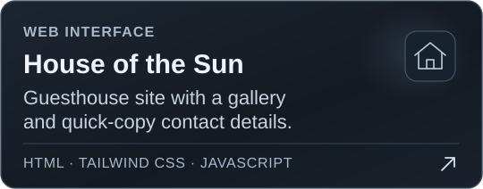</a>
  <a href="https://github.com/YgalaxyY/Ballet-Arts-Harmony">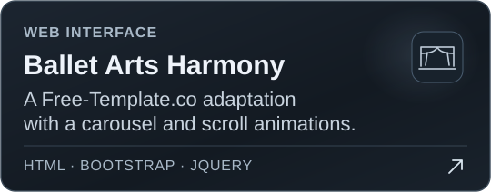</a>

I'm exploring everyday automation, connecting services through APIs and using existing models in small applications. I'm also interested in local LLMs and interfaces for working with them.

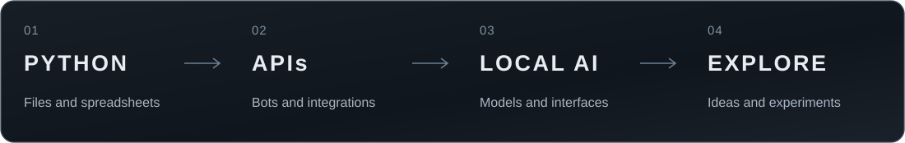

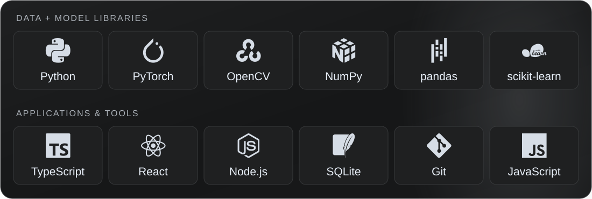

The projects use **Python, pandas, openpyxl, aiogram, JSON and HTTP APIs**, alongside tools for local models, web interfaces and image processing. Each repository lists its own stack.

<a href="mailto:denis@burakovv.ru">denis@burakovv.ru</a> · <a href="https://t.me/YgalaxyY">Telegram</a> · <a href="README.md">Русский</a>

