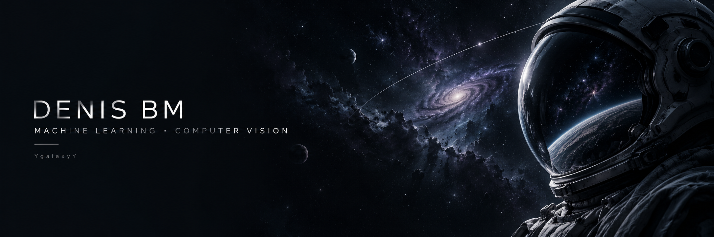

# Denis Bm

I work on **computer vision, multimodal learning and local LLM applications**. I'm a fifth-year student at Don State Technical University in Rostov-on-Don, looking for an **ML engineering internship**.

My current research explores how video quality can guide audio-visual fusion for deepfake detection. I also build Python tools and application interfaces that make models useful outside a notebook.

[Telegram](https://t.me/ygalaxyy) · [Обо мне на русском](README.ru.md)

## Selected work

| Project | My work | Status |
| --- | --- | --- |
| [DeepSynth Research](https://github.com/YgalaxyY/deepsynth-research) | Quality-aware audio-visual fusion; EfficientNet-B4 features, MFCCs and a source-group evaluation protocol. | Research prototype; corrected-protocol benchmarks pending. |
| [Cardora](https://github.com/YgalaxyY/Cardora-AI-Automation) | A desktop workflow combining image upscaling, Photoshop and spreadsheet automation. | Product showcase; application source is not in this repository. |
| [GalaxyOS BookMarkCore](https://github.com/YgalaxyY/GalaxyOS_BookMarkCore) | Python Telegram bot using an LLM API to organize links and update a bookmark page. | Application source available. |
| [Local LLM Roleplay Lab](https://github.com/YgalaxyY/local-llm-roleplay-lab) | Local-model integration, simplified SillyTavern UI and local/LAN deployment documentation. | Integration and customization; upstream framework credited. |
| [Eco Banking Tracker](https://github.com/YgalaxyY/eco-banking-tracker) | React/TypeScript dashboard, Express API, SQLite models and illustrative impact analytics. | Educational full-stack prototype. |

## Tools I use

**ML & data:** Python, PyTorch, torchvision, OpenCV, NumPy, pandas, scikit-learn, librosa.

**Applications:** TypeScript, React, Node.js, Express, SQLite, Git, REST APIs.

## More engineering work

[C# JSXBIN decoder](https://github.com/YgalaxyY/Adobe-JSXBIN-Decoder) · [Local agent setup experiment](https://github.com/YgalaxyY/Swarm-of-agents) · [Excel consolidation utility](https://github.com/YgalaxyY/concatenate_multiple_excel) · [All repositories](https://github.com/YgalaxyY?tab=repositories)

## What I'm working toward

Reproducible experiments, clearer evaluation protocols and small, usable ML applications. I'm interested in internship work involving **computer vision, multimodal models or applied LLM systems**.
