
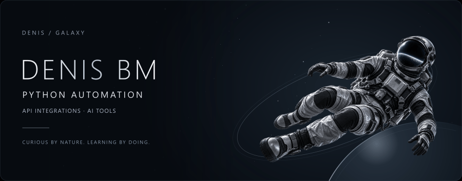

  
  
  
  

### Привет, я Денис

Занимаюсь **Python, автоматизацией и AI-инструментами**: от обработки файлов и таблиц до Telegram-ботов, API и локальных языковых моделей. Здесь собраны Cardora Studio, мой коммерческий продукт, а также личные и учебные проекты.

Учусь на специалитете **«Компьютерная безопасность» в ДГТУ**, Ростов-на-Дону. Планируемый выпуск — **2028 год**.

  

Подробности реализации, релизы и инструкции доступны по ссылкам на карточках.

<a href="https://github.com/YgalaxyY/GalaxyOS_BookMarkCore"></a>

  
  

  <a href="https://github.com/YgalaxyY/concatenate_multiple_excel">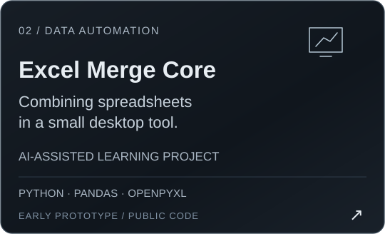</a>&nbsp;&nbsp;
  <a href="https://github.com/YgalaxyY/Cardora-AI-Automation">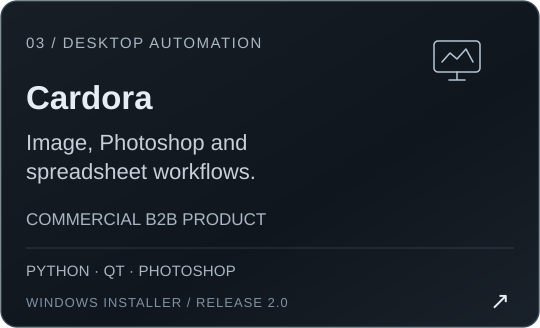</a>

  <a href="https://github.com/YgalaxyY/deepsynth-research">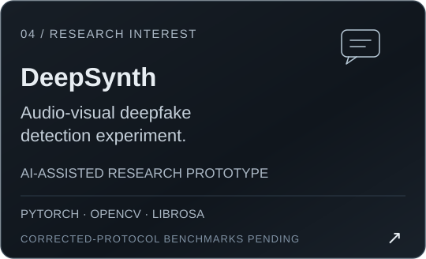</a>&nbsp;&nbsp;
  <a href="https://github.com/YgalaxyY/local-llm-roleplay-lab">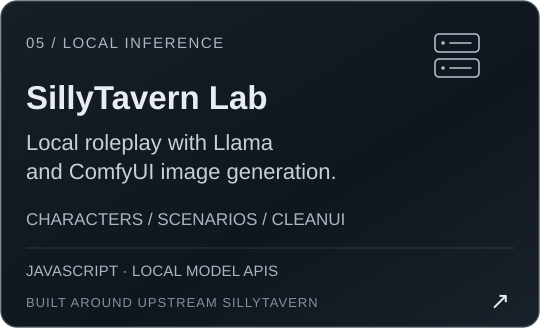</a>

### Другие проекты

  <a href="https://github.com/YgalaxyY/eco-banking-tracker">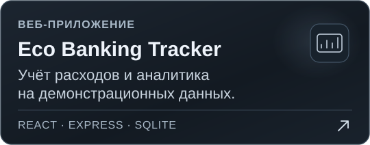</a>
  <a href="https://github.com/YgalaxyY/Sawing-Company">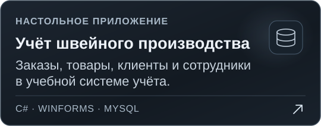</a>

  <a href="https://github.com/YgalaxyY/Swarm-of-agents">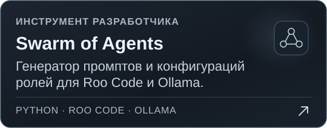</a>
  <a href="https://github.com/YgalaxyY/Adobe-JSXBIN-Decoder">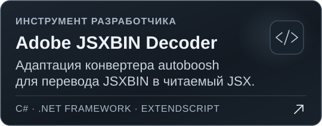</a>

  <a href="https://github.com/YgalaxyY/House-of-the-sun">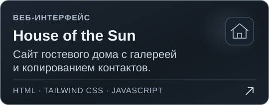</a>
  <a href="https://github.com/YgalaxyY/Ballet-Arts-Harmony">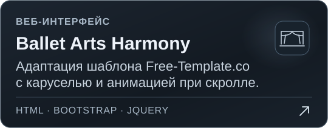</a>

Изучаю, как автоматизировать повседневные задачи, связывать сервисы через API и использовать готовые модели в небольших приложениях. Отдельный интерес — локальные LLM и интерфейсы для работы с ними.

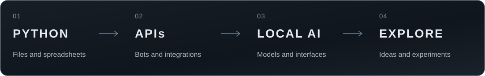

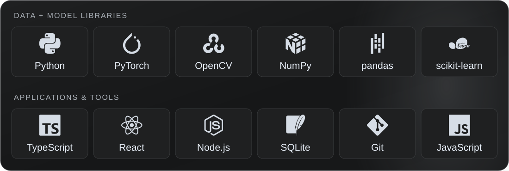

В проектах встречаются **Python, pandas, openpyxl, aiogram, JSON и HTTP API**, а также инструменты для локальных моделей, веб-интерфейсов и обработки изображений. Стек каждого проекта указан в его репозитории.

<a href="mailto:denis@burakovv.ru">denis@burakovv.ru</a> · <a href="https://t.me/YgalaxyY">Telegram</a> · <a href="README.en.md">English</a>

