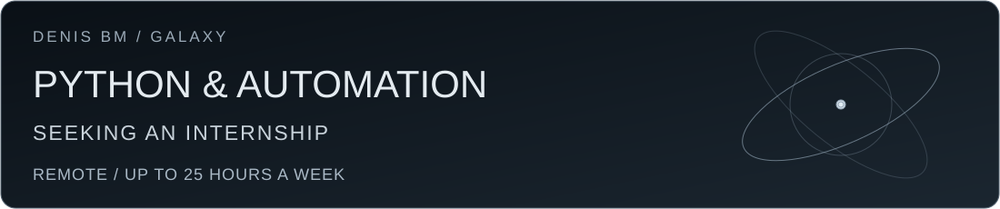
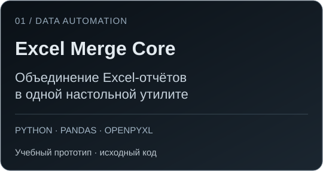
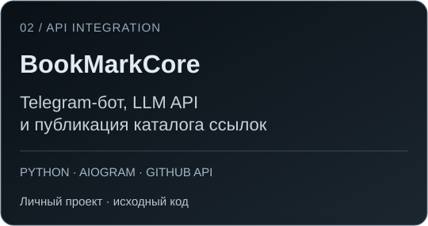
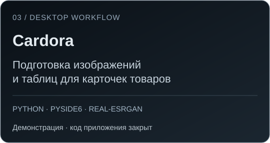
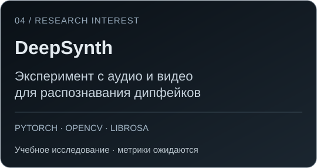

<a href="mailto:denis@burakovv.ru">Email</a> · <a href="https://t.me/YgalaxyY">Telegram</a> · <a href="README.en.md">English</a>

## Привет, я Денис

Ищу **удалённую стажировку по Python или позицию начинающего разработчика с наставником**. Интересуют автоматизация работы с файлами и таблицами, Telegram-боты, API и интеграция готовых AI-сервисов.

Учусь на **5-м курсе специалитета «Компьютерная безопасность» в ДГТУ**, Ростов-на-Дону. Планируемый выпуск — **2028 год**. Могу уделять работе **до 25 часов в неделю**; рассматриваю частичную занятость и гибкий график.

## Проекты

Это личные и учебные проекты, созданные с активной помощью AI-инструментов. Сейчас я укрепляю основы Python и разбираю их реализацию. В описаниях указаны технологии конкретных проектов, доступные исходники и ограничения.

&nbsp;

- **[Excel Merge Core](https://github.com/YgalaxyY/concatenate_multiple_excel)** — небольшой Python-скрипт с интерфейсом для объединения таблиц. В README описаны требования к файлам и ограничения ранней реализации.
- **[BookMarkCore](https://github.com/YgalaxyY/GalaxyOS_BookMarkCore)** — обработка текстов и ссылок из Telegram, классификация через готовые языковые модели и обновление HTML через GitHub API. Это интеграция моделей, а не их обучение.

&nbsp;

- **[Cardora](https://github.com/YgalaxyY/Cardora-AI-Automation)** — демонстрация настольного инструмента для подготовки карточек товаров: изображения, Photoshop и Excel. В открытом репозитории доступны описание и материалы проекта; код приложения не опубликован.
- **[DeepSynth Research](https://github.com/YgalaxyY/deepsynth-research)** — учебный эксперимент с объединением аудио- и видеопризнаков для детекции дипфейков. Исходники и методика доступны; результаты по исправленному протоколу ещё предстоит получить.

Другие личные и учебные проекты

- [Local LLM Roleplay Lab](https://github.com/YgalaxyY/local-llm-roleplay-lab) — настройка локальных моделей и интерфейса на базе SillyTavern. Фреймворк и модели принадлежат их авторам.
- [Eco Banking Tracker](https://github.com/YgalaxyY/eco-banking-tracker) — учебное веб-приложение с демонстрационными данными, без банковской интеграции.
- [Учётная система](https://github.com/YgalaxyY/Sawing-Company) — учебный проект на C#, WinForms и MySQL.
- [Swarm of Agents](https://github.com/YgalaxyY/Swarm-of-agents) — эксперимент с настройкой ролей для Roo Code и Ollama.
- [Adobe JSXBIN Decoder](https://github.com/YgalaxyY/Adobe-JSXBIN-Decoder) — репозиторий инструмента декодирования JSXBIN на C#.
- [House of the Sun](https://github.com/YgalaxyY/House-of-the-sun) и [Ballet Arts Harmony](https://github.com/YgalaxyY/Ballet-Arts-Harmony) — веб-интерфейсы.

## Что изучаю и с чем работал в проектах

Основное направление — **Python, файлы, JSON, pandas, openpyxl и HTTP API**. В проектах также использованы aiogram, GitHub API, готовые LLM и инструменты локального запуска моделей. Перечень отражает проектную практику; я ищу именно начальную позицию с наставничеством.

Есть опыт работы системным администратором в **Tatrum, сентябрь–октябрь 2024 года**: ЭДО, СКУД, 1С.

## Связаться

**[denis@burakovv.ru](mailto:denis@burakovv.ru)** · **[Telegram @YgalaxyY](https://t.me/YgalaxyY)**

Удалённо · до 25 часов в неделю · стажировка или начальная позиция по Python.

Оформление моего исследовательского портфолио

Сохранил анимацию из прежнего оформления, посвящённого интересу к машинному обучению.

