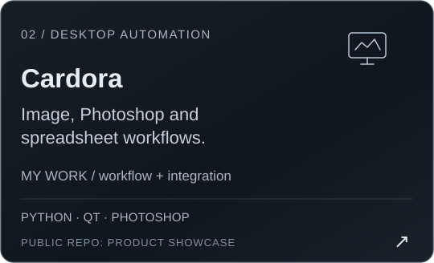
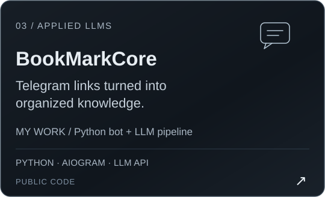
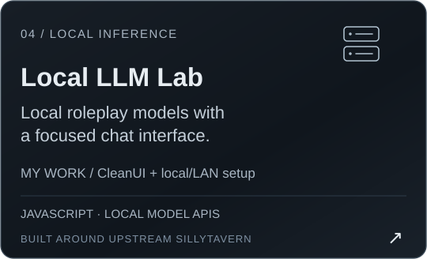
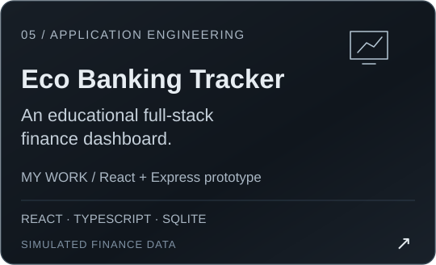
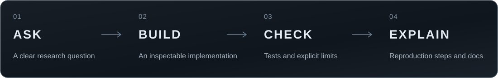
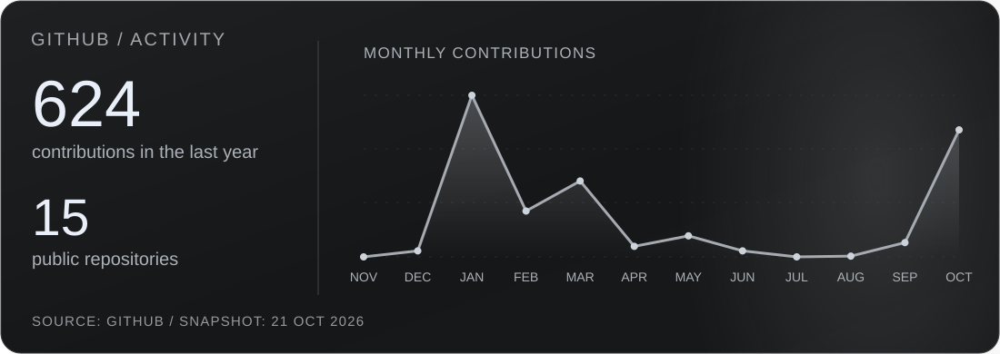

  

  
  
  
  

### Hi, I'm Denis.

I'm a fifth-year student at **Don State Technical University**, based in Rostov-on-Don, looking for an **ML engineering internship**.

My main research interest is **computer vision and multimodal learning**. In DeepSynth, I explore how image quality can guide the fusion of audio and visual predictions for deepfake detection.

I also build **local LLM integrations, Python automation and desktop tools**. I like work where an experiment becomes inspectable code, a usable interface and a clear explanation of its limits.

  <a href="https://github.com/YgalaxyY/deepsynth-research/tree/main/scripts">Source code</a> ·
  <a href="https://github.com/YgalaxyY/deepsynth-research/blob/main/docs/METHODOLOGY.md">Methodology</a> ·
  <a href="https://github.com/YgalaxyY/deepsynth-research/actions">Protocol checks</a>

  &nbsp;&nbsp;
  

  &nbsp;&nbsp;
  

<strong>More engineering work</strong>

- [Adobe JSXBIN Decoder](https://github.com/YgalaxyY/Adobe-JSXBIN-Decoder) — C# decoding tools and AST-oriented code.
- [Swarm of Agents](https://github.com/YgalaxyY/Swarm-of-agents) — an experiment configuring local Roo Code / Ollama agent roles.
- [Excel consolidation](https://github.com/YgalaxyY/concatenate_multiple_excel) — a Python utility for combining spreadsheet reports.
- [Sewing factory management](https://github.com/YgalaxyY/Sawing-Company) — a student WinForms and MySQL application.
- [House of the Sun](https://github.com/YgalaxyY/House-of-the-sun) and [Ballet Arts Harmony](https://github.com/YgalaxyY/Ballet-Arts-Harmony) — web interfaces and visual design work.

The deepfake project is ongoing research; benchmarks under the corrected evaluation protocol are pending. SillyTavern and pretrained models are credited to their upstream authors in the project repositories.

GitHub activity · dated snapshot

<a href="https://t.me/ygalaxyy">Telegram</a> · <a href="https://github.com/YgalaxyY?tab=repositories">Repositories</a> · <a href="README.ru.md">Русская версия</a>

