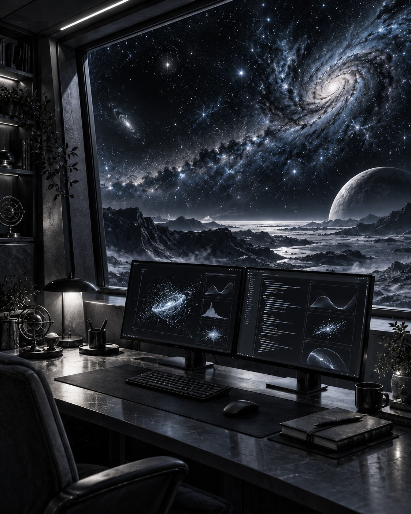
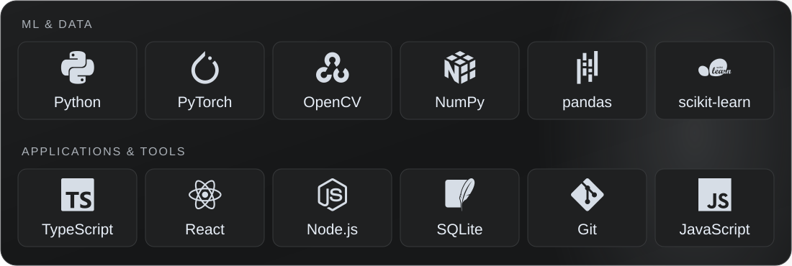

  

  

  
  
  
  

### Hi, I'm Denis.

I build practical tools around **models, data and interfaces**.

I'm a fifth-year student at **Don State Technical University**, based in Rostov-on-Don. My current research explores **quality-aware audio-visual fusion for deepfake detection**.

My work also spans local language models, Python automation and desktop applications — connecting experiments with something people can use.

**Currently focused on**

- Computer vision & multimodal learning
- Reproducible model evaluation
- Local LLM applications

 

<strong>More engineering work</strong>

- [Adobe JSXBIN Decoder](https://github.com/YgalaxyY/Adobe-JSXBIN-Decoder) — C# decoding tools and AST-oriented code.
- [Swarm of Agents](https://github.com/YgalaxyY/Swarm-of-agents) — an experiment configuring local Roo Code / Ollama agent roles.
- [Excel consolidation](https://github.com/YgalaxyY/concatenate_multiple_excel) — a Python utility for combining spreadsheet reports.
- [Sewing factory management](https://github.com/YgalaxyY/Sawing-Company) — a student WinForms and MySQL application.
- [House of the Sun](https://github.com/YgalaxyY/House-of-the-sun) and [Ballet Arts Harmony](https://github.com/YgalaxyY/Ballet-Arts-Harmony) — web interfaces and visual design work.

The deepfake project is ongoing research; benchmarks under the corrected evaluation protocol are pending. SillyTavern and pretrained models are credited to their upstream authors in the project repositories.

  

