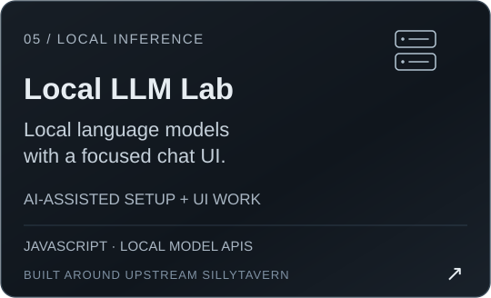
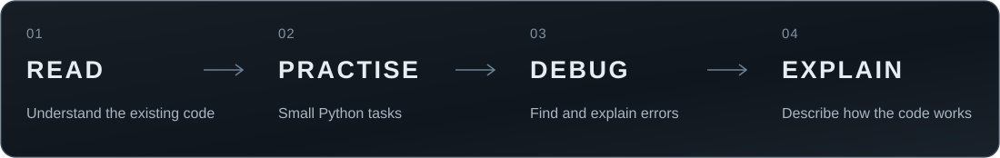

  
  
  
  

### Привет, я Денис

Ищу **удалённую стажировку по Python или начальную позицию с наставником**. Интересуют автоматизация файлов и таблиц, Telegram-боты, API и интеграция готовых AI-сервисов.

Учусь на **5-м курсе специалитета «Компьютерная безопасность» в ДГТУ**, Ростов-на-Дону. Планируемый выпуск — **2028 год**. Доступен **до 25 часов в неделю**, рассматриваю частичную занятость и гибкий график.

Проекты созданы с активной помощью AI-инструментов. В описаниях указаны доступные исходники, использованные технологии и ограничения.

<a href="https://github.com/YgalaxyY/GalaxyOS_BookMarkCore/blob/main/main.py">Исходный код</a> · <a href="https://github.com/YgalaxyY/GalaxyOS_BookMarkCore#readme">Настройка и ограничения</a>

  &nbsp;&nbsp;
  

  &nbsp;&nbsp;
  

<strong>Другие проекты</strong>

- [Eco Banking Tracker](https://github.com/YgalaxyY/eco-banking-tracker) — учебное веб-приложение с демонстрационными данными, без банковской интеграции.
- [Учётная система](https://github.com/YgalaxyY/Sawing-Company) — учебный проект на C#, WinForms и MySQL.
- [Swarm of Agents](https://github.com/YgalaxyY/Swarm-of-agents) — эксперимент с конфигурацией ролей для Roo Code и Ollama.
- [Adobe JSXBIN Decoder](https://github.com/YgalaxyY/Adobe-JSXBIN-Decoder) — репозиторий инструмента декодирования JSXBIN на C#.
- [House of the Sun](https://github.com/YgalaxyY/House-of-the-sun) и [Ballet Arts Harmony](https://github.com/YgalaxyY/Ballet-Arts-Harmony) — веб-интерфейсы.

Укрепляю основы Python и разбираю реализацию своих проектов: работа с файлами, JSON, таблицами и HTTP API. Моя цель — уверенно читать код, вносить небольшие изменения и объяснять результат.

Это технологии портфолио. Основной фокус подготовки — **Python, pandas, openpyxl, JSON и API**; ищу начальную позицию с наставничеством.

Есть опыт работы системным администратором в **Tatrum, сентябрь–октябрь 2024 года**: ЭДО, СКУД, 1С.

<a href="mailto:denis@burakovv.ru">denis@burakovv.ru</a> · <a href="https://t.me/YgalaxyY">Telegram</a> · <a href="README.en.md">English</a>

