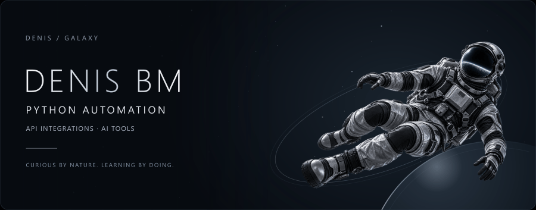
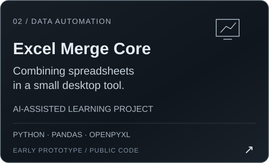
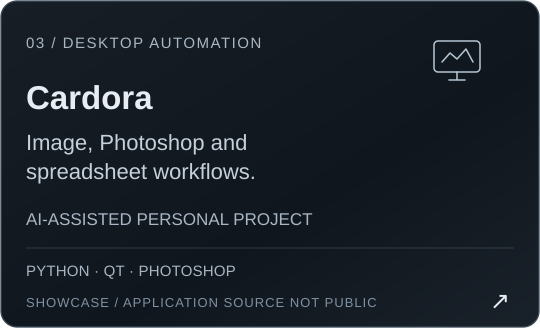
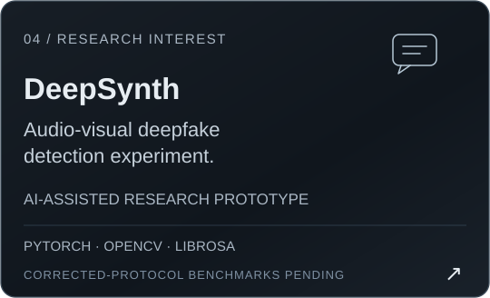
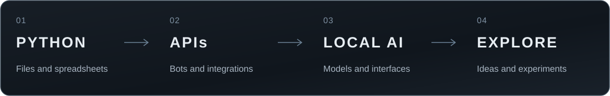
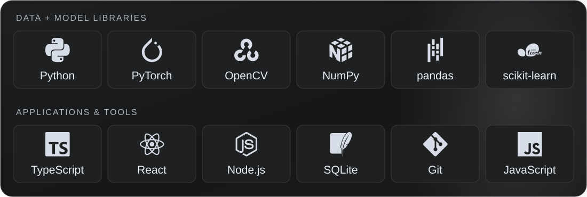

  
  
  
  

### Привет, я Денис

Интересуюсь **Python, автоматизацией и AI-инструментами**: от обработки файлов и таблиц до Telegram-ботов, API и локальных языковых моделей. Здесь собраны мои личные проекты, учебные работы и эксперименты.

Учусь на специалитете **«Компьютерная безопасность» в ДГТУ**, Ростов-на-Дону. Планируемый выпуск — **2028 год**.

Личные и учебные проекты. Реализация, запуск и текущий статус — в описаниях репозиториев.

<a href="https://github.com/YgalaxyY/GalaxyOS_BookMarkCore/blob/main/main.py">Исходный код</a> · <a href="https://github.com/YgalaxyY/GalaxyOS_BookMarkCore#readme">Настройка и ограничения</a>

  &nbsp;&nbsp;
  

  &nbsp;&nbsp;
  

<strong>Другие проекты</strong>

- [Eco Banking Tracker](https://github.com/YgalaxyY/eco-banking-tracker) — учебное веб-приложение с демонстрационными данными, без банковской интеграции.
- [Учётная система](https://github.com/YgalaxyY/Sawing-Company) — учебный проект на C#, WinForms и MySQL.
- [Swarm of Agents](https://github.com/YgalaxyY/Swarm-of-agents) — эксперимент с конфигурацией ролей для Roo Code и Ollama.
- [Adobe JSXBIN Decoder](https://github.com/YgalaxyY/Adobe-JSXBIN-Decoder) — репозиторий инструмента декодирования JSXBIN на C#.
- [House of the Sun](https://github.com/YgalaxyY/House-of-the-sun) и [Ballet Arts Harmony](https://github.com/YgalaxyY/Ballet-Arts-Harmony) — веб-интерфейсы.

Изучаю, как автоматизировать повседневные задачи, связывать сервисы через API и использовать готовые модели в небольших приложениях. Отдельный интерес — локальные LLM и интерфейсы для работы с ними.

В проектах встречаются **Python, pandas, openpyxl, aiogram, JSON и HTTP API**, а также инструменты для локальных моделей, веб-интерфейсов и обработки изображений. Стек каждого проекта указан в его репозитории.

<a href="mailto:denis@burakovv.ru">denis@burakovv.ru</a> · <a href="https://t.me/YgalaxyY">Telegram</a> · <a href="README.en.md">English</a>

