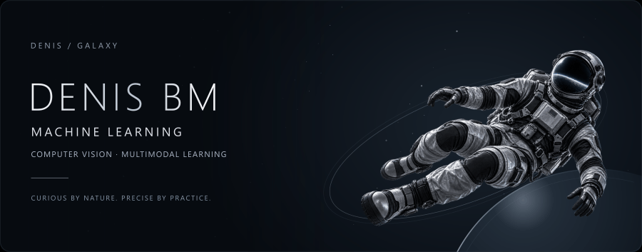

# Денис / Denis Bm

Студент 5 курса ДГТУ, Ростов-на-Дону. Ищу позицию **junior ML-инженера или стажировку**, готов к переезду в **ОАЭ (Дубай, Абу-Даби)**. Интересуюсь компьютерным зрением, мультимодальным обучением и приложениями с локальными языковыми моделями.

## Основные проекты

- **[DeepSynth Research](https://github.com/YgalaxyY/deepsynth-research)** — исследование объединения аудио- и видеопризнаков для детекции дипфейков с учётом качества изображения. Прототип на PyTorch; результаты после исправления протокола ещё предстоит пересчитать.
- **[Cardora](https://github.com/YgalaxyY/Cardora-AI-Automation)** — демонстрация настольного инструмента автоматизации работы с изображениями и таблицами. Публичный репозиторий содержит презентацию продукта, а не исходники приложения.
- **[GalaxyOS BookMarkCore](https://github.com/YgalaxyY/GalaxyOS_BookMarkCore)** — Python-бот для организации ссылок с помощью LLM API.
- **[Local LLM Roleplay Lab](https://github.com/YgalaxyY/local-llm-roleplay-lab)** — настройка локальных ролевых моделей, упрощение интерфейса SillyTavern, документирование локального и сетевого запуска. Мой вклад — интеграция и оформление; SillyTavern создан его авторами.
- **[Eco Banking Tracker](https://github.com/YgalaxyY/eco-banking-tracker)** — учебное приложение на React, TypeScript, Express и SQLite. Транзакции и экологические оценки демонстрационные; интеграции с банком нет.

## Другие работы

[Декодер JSXBIN на C#](https://github.com/YgalaxyY/Adobe-JSXBIN-Decoder), [эксперимент с настройкой локальных агентов](https://github.com/YgalaxyY/Swarm-of-agents), [объединение Excel-отчётов](https://github.com/YgalaxyY/concatenate_multiple_excel), веб-интерфейсы и учебные приложения с базами данных.

---

## Подход к работе

Понятный исследовательский вопрос, проверяемый код, явные ограничения метода и инструкция для воспроизведения. Мне интересно соединять эксперименты с моделями, прикладную разработку и удобные интерфейсы.

---

Python · PyTorch · OpenCV · NumPy · pandas · scikit-learn · librosa · TypeScript · React · SQLite · Git

[Связаться в Telegram](https://t.me/ygalaxyy) · [English profile](README.md)
